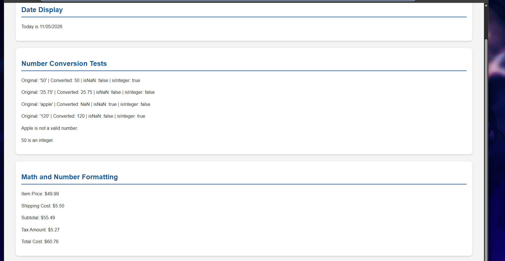

# COMP 484 - Homework 9
## JavaScript Built-In Objects

For this assignment, I made a webpage that uses JavaScript to display the current date, convert different values into numbers, and do some basic calculations. I also added some CSS to make the page look cleaner and easier to read.

## Features

### Date Display
- Shows the current date in MM/DD/YYYY format.
- Uses the Date object to get the month, day, and year.

### Number Conversion
- Converts four different values using Number().
- Checks if each value is NaN or an integer.
- Uses if/else statements to display different messages.

### Math and Number Formatting
- Calculates the total cost of an item with shipping and tax.
- Uses addition and multiplication.
- Uses toFixed(2) to display prices with two decimal places.

## JavaScript Objects and Methods Used

- Date()
- getMonth()
- getDate()
- getFullYear()
- String()
- padStart()
- Number()
- Number.isNaN()
- Number.isInteger()
- toFixed()
- document.getElementById()

## GitHub Pages Link

[View My Website](https://jaspreet1805.github.io/comp484-HW9/)

## Screenshot

## Reflection

The easiest part of this assignment was setting up the variables and doing the calculations since they were pretty straightforward. The hardest part was getting the date to show up correctly and making sure everything displayed on the webpage. I learned that the Date object starts counting months from zero, so I had to add one to get the correct month. I also learned how Number() converts strings into numbers and how to check if a value is NaN or an integer. I got a better understanding of how JavaScript connects to HTML and how to display results directly on the page instead of just in the console.